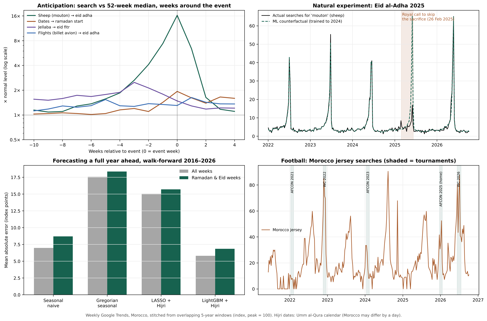

# Morocco Markets Research

Three empirical studies on Moroccan markets and consumers, by Saad Qatib (BSc International Economics & Finance, Bocconi University).

| # | Study | Methods | Headline result |
|---|---|---|---|
| 1 | [USD/MAD, phosphate prices & the MASI](01_usdmad_phosphate_masi/) | Breitung-Candelon frequency-domain causality, OLS with HAC errors, Granger, Diebold-Yilmaz connectedness | Phosphate Granger-causes USD/MAD at 2-4 and 10+ month cycles, but entirely through the dollar: the 60/40 EUR/USD peg basket explains 93% of USD/MAD variance |
| 2 | [Event-driven consumer demand (machine learning)](02_consumer_demand_ml/) | LightGBM, LASSO, walk-forward validation, ML counterfactual with placebo | Hijri-calendar features cut year-ahead forecast error by 16% vs same-week-last-year and 67% vs a Gregorian seasonal model; the 2025 call to skip the Eid al-Adha sacrifice cut sheep demand 74% below forecast |
| 3 | [Rainfall & the Moroccan stock market](03_rainfall_masi/) | ERA5 rainfall index, predictive regressions, sector portfolios, backtest | Rainfall explains 62% of cereal-output variance (ρ = 0.79) but has no significant link to MASI or sector returns |

Study 1 is research conducted with Dr. Amine Ben Amar (UM6P). Studies 2 and 3 are self-directed.

Each folder has a `SUMMARY.md` with full results, the analysis script, result files (`*.json`, `*.csv`) and charts.



## Data

| Source | Used in | Included here |
|---|---|---|
| Google Trends, Morocco, weekly (2010-2026) | 2 | Yes (`02_consumer_demand_ml/data/gtrends_raw.json`) |
| Hijri event calendar (Umm al-Qura) | 2 | Yes |
| Open-Meteo ERA5 reanalysis (daily rainfall, 8 cereal-belt sites; Casablanca weather) | 3 | Yes |
| World Bank WDI (GDP, agriculture, cereal production) | 3 | Yes |
| World Bank Pink Sheet (phosphate rock, DAP, Brent) | 1, 3 | No, download `CMO-Historical-Data-Monthly.xlsx` from [worldbank.org/commodities](https://www.worldbank.org/en/research/commodity-markets) |
| Investing.com (MASI, USD/MAD, EUR/USD, 67 Casablanca-listed stocks) | 1, 3 | No (third-party terms), export from Investing.com and save as described below |

Expected files for the non-included sources:
- `01_usdmad_phosphate_masi/data/fx_monthly.csv`: `date,usdmad,eurusd` (monthly, `YYYY-MM`)
- `01_usdmad_phosphate_masi/data/masi_monthly.csv`: `date,masi`
- `01_usdmad_phosphate_masi/data/CMO-Historical-Data-Monthly.xlsx`
- `03_rainfall_masi/data/masi_daily.csv`: `date,masi` (daily)
- `03_rainfall_masi/data/stocks_monthly.csv`: `date,sym,close` (monthly, Casablanca tickers)

## Reproduce

```bash
pip install -r requirements.txt
cd 02_consumer_demand_ml && python consumer.py      # runs on the included data
cd ../03_rainfall_masi && python rain.py            # needs the Investing.com files above
cd ../01_usdmad_phosphate_masi && python analysis.py && python bc_usdmad.py
```

## Caveats

- Google Trends measures search intent, not spending; weekly series are stitched from overlapping 5-year windows.
- Hijri dates follow the Umm al-Qura calendar; Morocco's moon-sighting can differ by a day.
- Stock data are price returns for currently listed companies (no dividends, survivorship bias).
- ERA5 is a reanalysis model, not station observations.
